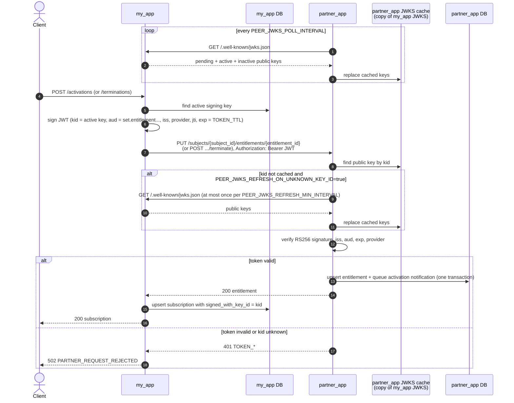
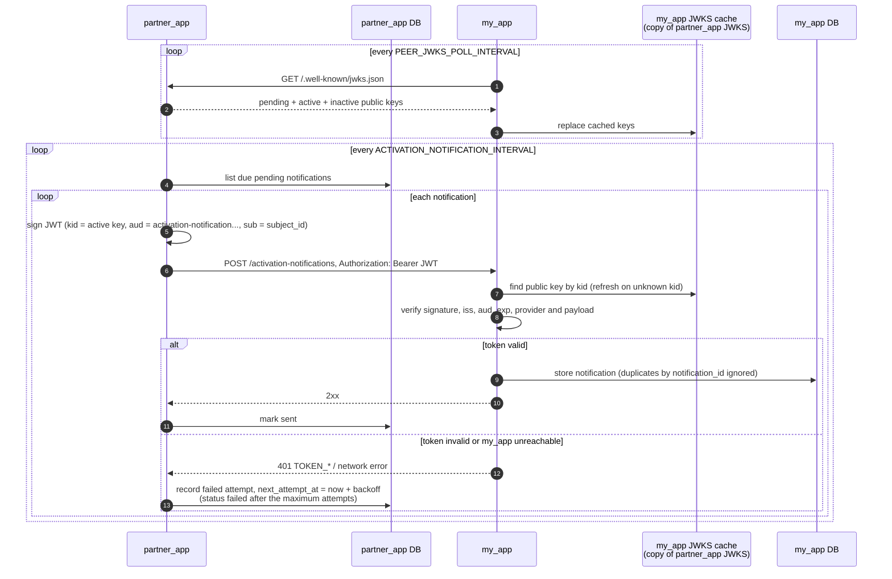

# JWKS key rotation simulation

Two Go services that reproduce a streaming provider partner integration built on JWT and JWKS, scaled down from days to minutes so a full key rotation can be watched in one sitting.

| App | Plays | Module | Port |
|---|---|---|---|
| `my_app` | the partner (us) | `github.com/nasrulfuad/auto-key-rotation-strategy/my_app` | 8081 |
| `partner_app` | Provider (Entitlement API owner) | `github.com/nasrulfuad/auto-key-rotation-strategy/partner_app` | 8082 |

Trust goes both ways. Each app owns an RSA signing key set, rotates it on its own schedule, publishes the public half at `/.well-known/jwks.json`, and verifies the other app's tokens through a cached copy of the other app's JWKS.

- `my_app` signs the bearer token of every activation and termination it sends to `partner_app` (`aud` = `set.entitlement...`).
- `partner_app` signs every activation notification webhook it sends back to `my_app` (`aud` = `activation-notification...`).

## What is inside

| Area | Choice |
|---|---|
| Language | Go 1.27.3, one module per app, tied together by `go.work` |
| HTTP | echo v5 (`internal/infra/echo`), handlers in `internal/adapter/controller/http` |
| Tokens | `golang-jwt/jwt/v5`, RS256, RSA keys generated in `internal/infra/rsakey`, JWKS served and cached in `internal/infra/jwks` |
| Key storage | PostgreSQL 17 through pgx v5; private keys sealed with AES-GCM (`internal/infra/sealer`, `KEY_ENCRYPTION_KEY`) before they are stored |
| SQL | sqlc generates `internal/store` from `query/*.sql`; goose migrations in `migrations/` are embedded and applied on boot |
| Scheduler | `internal/infra/scheduler` runs the jobs below; a PostgreSQL advisory lock (`pg_try_advisory_xact_lock`) lets only one replica run a job at a time |
| API docs | swag annotations → `api/openapi.json` (OpenAPI 3.1), served with Swagger UI at `/docs` |
| Tests | testify, mockery v3 mocks from `.mockery.yml`, integration tests behind the `integration` tag against a real database |
| Quality | golangci-lint with depguard ring rules and gosec; govulncheck, osv-scanner, gitleaks, hadolint and trivy (see [Security scans](#security-scans)) |
| Runtime | multi-stage `Dockerfile` per app (`dev` stage under air, `runtime` stage on alpine as a non-root user), `docker-compose.yml` + `docker-compose.dev.yml` |

Scheduled jobs:

| Job | App | Does |
|---|---|---|
| `ensure_signing_keys` | both | creates the next key as pending before the current key stops signing (also run once at startup) |
| `track_signing_key_statuses` | both | logs every phase change: pending, activated, retired, expired |
| `delete_expired_signing_keys` | both | removes keys past `delete_after`, which drops them from the JWKS |
| `refresh_peer_signing_keys` | both | polls the other app's JWKS every `PEER_JWKS_POLL_INTERVAL` |
| `deliver_activation_notifications` | `partner_app` | sends queued webhooks to `my_app` with retry and backoff |

Repository layout:

```
.
├── my_app/, partner_app/         one service each, same layout:
│   ├── cmd/server                entry point; cmd/fixopenapi post-processes the generated spec
│   ├── internal/domain           entities, statuses, domain errors (no framework imports)
│   ├── internal/usecase          interactors: signingkey, peersigningkey, authentication, subscription /
│   │                             entitlement, activationnotification
│   ├── internal/adapter          controller, presenter, apidoc, repository (+ postgres), gateway (+ http)
│   ├── internal/infra            config, echo, jwt, jwks, rsakey, sealer, scheduler, postgres, logging, systemclock
│   ├── internal/di               composition root
│   ├── internal/store            sqlc output (generated)
│   ├── internal/integration      end-to-end tests with a fake clock
│   ├── query/, migrations/       sqlc queries and goose migrations
│   ├── api/openapi.json          generated spec
│   └── .golangci.yml, .mockery.yml, sqlc.yaml, osv-scanner.toml
├── docker/postgres/init.sql      creates the my_app and partner_app databases
├── scripts/demo.sh               traffic generator behind `make demo`
├── .github/                      security workflow and Dependabot
├── .githooks/pre-commit          gitleaks on staged changes (`make hooks`)
└── Makefile                      root targets that fan out to both apps
```

The dependency rule is domain ← usecase ← adapter/infra: use cases depend only on interfaces declared in `adapter/repository`, `adapter/gateway` or the infra package, and depguard fails the lint when a ring points outward. `my_app/rules/rules.md` and `CLAUDE.md` hold the full naming and layering rules.

## Integration flows

### my_app → partner_app: activation and termination

`my_app` signs a short-lived JWT with its active key and calls the Entitlement API. `partner_app` verifies the token against its cached copy of the `my_app` JWKS, which the `refresh_peer_signing_keys` job refreshes every `PEER_JWKS_POLL_INTERVAL`.



### partner_app → my_app: activation notification webhook

Every entitlement change queues a notification in the same transaction. The `deliver_activation_notifications` job sends due notifications every `ACTIVATION_NOTIFICATION_INTERVAL`, signed with the active `partner_app` key, and retries with backoff until the maximum attempts are reached.



## Key lifecycle

| Phase | Default | In JWKS | Signs | Its tokens |
|---|---|---|---|---|
| pending (newly introduced) | `KEY_PENDING_DURATION=5m` | yes | no | — |
| active (primary signing key) | `KEY_ACTIVE_DURATION=20m` | yes | **yes** | valid |
| inactive | `KEY_INACTIVE_DURATION=10m` | yes | no | **still valid** |
| deleted | — | no | no | **rejected** |

The next key is created `KEY_PENDING_DURATION` before the current key stops signing and becomes active exactly when the current key ends, so there is never a gap and never two signing keys. The status is derived from four timestamps (`introduced_at`, `active_from`, `active_until`, `delete_after`); there is no status column. `TOKEN_TTL` must not exceed `KEY_INACTIVE_DURATION`, which guarantees a token signed at the last second of the active phase verifies until it expires.

`POST /signing-keys/rotate` forces a rotation on demand without skipping the pending phase: the next key is published at once and signs after `KEY_PENDING_DURATION`, and the current key's `active_until` moves to that instant (its inactive phase follows as usual). It is rejected with `409 SIGNING_KEY_ALREADY_PENDING` while a pending key exists, so the scheduler and manual rotations never stack. The endpoint is unauthenticated because this is a sandbox; a real deployment must protect it.

```mermaid
gantt
    dateFormat HH:mm
    axisFormat %H:%M
    section Key 1
    Active    :crit, k1a, 00:00, 20m
    Inactive  :k1i, after k1a, 10m
    section Key 2
    Pending   :k2p, 00:15, 5m
    Active    :crit, k2a, after k2p, 20m
    Inactive  :k2i, after k2a, 10m
    section Key 3
    Pending   :k3p, 00:35, 5m
    Active    :crit, k3a, after k3p, 20m
```



## Quick start

```
make up        # postgres + both apps, fast profile from .env.example (30s / 2m / 1m)
make dev       # same, but both apps run under air: saving a .go/.sql/.json file rebuilds and restarts that app
make demo      # activate / terminate every 3s and print which kid signed each side
make logs      # watch "signing key created", "signing key activated", "signing key retired", "peer signing key discovered", "signing key deleted"
make logs-my-app / make logs-partner-app   # same, one app only
make down-v    # remove everything including the database volume
```

Every log line carries `source`: `api` lines belong to one HTTP request and share its `log_id` (also returned as the `X-Log-ID` response header); `tick` lines belong to one scheduler run and carry `job` plus that run's `log_id`.

Defaults without `.env` are the 5m / 20m / 10m production-like schedule. `PARTNER_APP_KEY_PENDING_DURATION`, `PARTNER_APP_KEY_ACTIVE_DURATION` and `PARTNER_APP_KEY_INACTIVE_DURATION` give `partner_app` its own schedule; left empty, it uses the shared `KEY_*_DURATION` values. `podman compose` is used when podman is installed, `docker compose` otherwise.

API docs (Swagger UI over the generated OpenAPI 3.1 spec, served only when `ENABLE_API_DOCS=true`, which compose sets by default):

- my_app: http://localhost:8081/docs (spec at `/openapi.json`)
- partner_app: http://localhost:8082/docs

The spec is generated from swag annotations on the handlers (`make docs`, `make -C <app> docs-check`). "Try it" works directly for `my_app` `/activations`, `/terminations` and `/subscriptions`; the `partner_app` entitlement endpoints need a bearer token signed by `my_app`, which is why every call to the partner goes through an activation or termination in `my_app`.

Manual calls:

```
curl -s -X POST localhost:8081/activations -H 'Content-Type: application/json' \
  -d '{"subject_id":"SUB001","entitlement_id":"ENT001","products":"com.partner.product1","offer":{"free_trial":"NONE"}}'
curl -s -X POST localhost:8081/terminations -H 'Content-Type: application/json' \
  -d '{"subject_id":"SUB001","entitlement_id":"ENT001"}'
curl -s localhost:8081/subscriptions
curl -s localhost:8081/activation-notifications
curl -s localhost:8082/.well-known/jwks.json
curl -s localhost:8082/signing-keys
curl -s -X POST localhost:8082/signing-keys/rotate
curl -s localhost:8082/peer-signing-keys
```

To see why the pending phase and polling matter, restart with `PEER_JWKS_POLL_INTERVAL=1h` and `PEER_JWKS_REFRESH_ON_UNKNOWN_KEY_ID=false`: every call fails with `401 TOKEN_SIGNING_KEY_NOT_FOUND` as soon as the peer starts signing with a key this side never fetched.

## Endpoints

`partner_app`

| Method | Path | Auth |
|---|---|---|
| GET | `/health`, `/health/db` | public |
| GET | `/docs`, `/openapi.json` | public, only with `ENABLE_API_DOCS=true` |
| GET | `/.well-known/jwks.json` | public |
| GET | `/signing-keys` | public, debug view of every key and its status |
| POST | `/signing-keys/rotate` | public, debug only; creates the next key as pending and ends the current key when it activates, `409 SIGNING_KEY_ALREADY_PENDING` while a pending key exists |
| GET | `/peer-signing-keys` | public, debug view of the cached `my_app` JWKS |
| PUT | `/subjects/:subject_id/entitlements/:entitlement_id` | bearer JWT from `my_app`, `aud` = `ENTITLEMENT_SET_AUDIENCE`; status `ACTIVE` (also reactivates) |
| POST | `/subjects/:subject_id/entitlements/:entitlement_id/terminate` | bearer JWT from `my_app`, `aud` = `ENTITLEMENT_SET_AUDIENCE`; status `TERMINATED` |
| GET | `/subjects/:subject_id/entitlements/:entitlement_id` | bearer JWT from `my_app`, `aud` = `ENTITLEMENT_GET_AUDIENCE` |
| GET | `/subjects/:subject_id/entitlements` | bearer JWT from `my_app`, `aud` = `ENTITLEMENT_GET_AUDIENCE` |

`my_app`

| Method | Path | Auth |
|---|---|---|
| GET | `/health`, `/health/db`, `/.well-known/jwks.json`, `/signing-keys`, `/peer-signing-keys` | public |
| POST | `/signing-keys/rotate` | public, debug only; same rotation as `partner_app` |
| GET | `/docs`, `/openapi.json` | public, only with `ENABLE_API_DOCS=true` |
| POST | `/activations` | public; signs with the active key, calls `partner_app` PUT entitlement, stores the subscription locally with `signed_with_key_id` |
| POST | `/terminations` | public; signs, calls `partner_app` terminate, stores the subscription locally |
| GET | `/subscriptions` | public, local subscriptions with the `kid` of the last call |
| POST | `/activation-notifications` | bearer JWT from `partner_app`, `aud` = `ACTIVATION_NOTIFICATION_AUDIENCE` |
| GET | `/activation-notifications` | public, shows the `key_id` that signed each received webhook |

Errors use one envelope: `{"error":{"code":"...","message":"..."}}`. Token failures are `401` with `TOKEN_INVALID`, `TOKEN_ISSUER_UNKNOWN`, `TOKEN_SIGNING_KEY_NOT_FOUND` or `TOKEN_CLAIM_INVALID`; the precise reason is logged, never returned.

## Tests

```
make test      # unit tests of both apps
make db        # postgres only
make test-db   # integration tests: full rotation with a fake clock, polling failure, entitlement + webhook flows
make lint      # gofmt, go vet, golangci-lint with depguard ring rules and gosec
make docs      # regenerate api/openapi.json of both apps from the swag annotations
```

## Security scans

Every scanner is pinned and runs through `go run` or a container (`podman` when present, else `docker`), so nothing has to be installed on the host. `.github/workflows/security.yml` runs the same targets on every push to `main`, every pull request and weekly; Dependabot bumps Go modules, base images and actions weekly.

```
make hooks            # once per clone: gitleaks scans staged changes on every commit
make vulncheck        # govulncheck: reachable vulnerabilities in dependencies and the stdlib
make scan-deps        # osv-scanner: every known vulnerability in go.mod, reachable or not
make secrets          # gitleaks over the whole git history
make lint-dockerfile  # hadolint on both Dockerfiles
make -C <app> check-go-version   # the Dockerfile golang tag must equal the go directive in go.mod (part of lint)
make scan-image       # build the runtime images and fail on fixable HIGH/CRITICAL findings (trivy)
make security         # all of the above; make verify runs them too, plus lint and tests
```

A reviewed false positive is ignored where its scanner looks: gitleaks fingerprints in `.gitleaksignore`, osv-scanner entries (with `reason` and `ignoreUntil`) in `<app>/osv-scanner.toml`, gosec rules in `<app>/.golangci.yml` with the reason they cannot apply.

## Not simulated

HTTPS/TLS and the SSL Labs "A" requirement, IP allowlists, the activation token flow for the provider web app, data reconciliation files, and the "do not sign with a new key until the peer has pulled it" probe (the pending phase plus polling covers it here).
